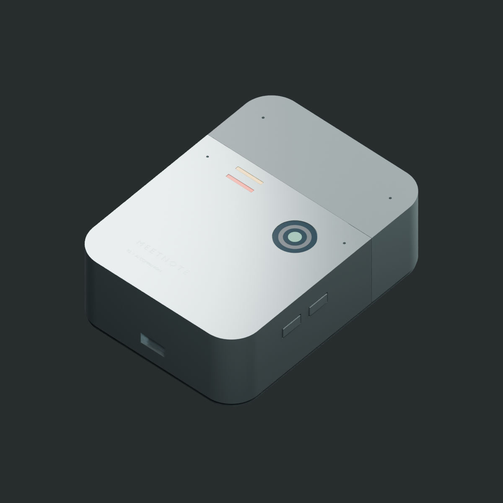

# MeetNote · 可挂佩的 AI 会议助手

[中文](README.md) · [English](README.en.md) · [在线主页](https://anweat.github.io/meetnote/)

> 从「桌面会议记录器」到「圆润、可挂佩的 AI 助手」：四轮产品定义、硬件架构、结构/热设计与成本研究。

**状态：工程概念研究 · `BLOCKED / NOT FOR FAB`。**
本项目交付的是可编辑、可复核的设计研究资料，**不可投板、不可采购、不可作为量产或性能承诺**。所有功耗、续航、温度、成本均为设计估算，尚无实物测试（E2 = 0）。

[](LICENSE-CC-BY-4.0)
[](LICENSE)
[](https://anweat.github.io/meetnote/)



## 这是什么

MeetNote 是一个「随手记录 → 本地可靠保存 → 服务器理解 → 有证据的回顾」的便携 AI 助手概念。设备以胸前挂佩为主要形态，拍照时摘下取景，多人会议时放到桌面。它要减少的是「掏手机、开应用、事后翻找」这三步，而不是再做一个录音笔。

项目不追求一次性画出成品，而是按 **R0 → R1 → R2 → R3** 四轮推进：每轮给出可编辑的工程文件、明确的计算口径、验证结果和**未关闭风险**，再决定下一轮是否值得继续。

**核心设计原则**

1. **知情同意与物理许可**：上电默认不采集；独立实体开关切断麦克风/相机许可，状态灯由真实采集轨驱动，软件只是补充。
2. **本地先可靠保存**：断网不影响录制；只有本地原子落盘成功才向用户显示「已保存」。
3. **有证据的候选，而非自动执行**：摘要、待办、决定只标为候选，必须能回溯到原始音频区间/照片，并经用户确认。
4. **先证明再承诺**：FPGA 是否保留、43 °C 触温、2 小时续航、300 元成本，都设了明确的实测门槛，未通过就不写进结论。
5. **研究等级透明**：所有结论标注 E0（设计估算）/ E1（本机工具验证）/ E2（实物测试），本轮 E2 为零。

## 四轮迭代一览

| 轮次 | 定位 | 关键产出 | 结论 |
|---|---|---|---|
| [R0](iterations/MeetNote-R0/) | 桌面 4–8 人会议记录器 | KiCad 四层载板草案（主图 + 7 子页）、FreeCAD 外壳、BOM、OpenAPI 草案、12 项本机软件测试、8 页原理图 PDF | 建立了可编辑基线；ERC 3 错 7 警、DRC 4 违规 + 93 未连接，**不可投板** |
| [R1](iterations/MeetNote-R1-design/) | 可挂佩 AI 助手（定位转向） | 产品与工程基线、离线交互原型 `design-review.html`、热/续航/成本敏感性计算 | 形态与交互成立度提升；68×90×26 mm 热筛查 FAIL（估算壳温约 62.8 °C） |
| [R2](iterations/MeetNote-R2-metal/) | 金属壳、贴合与运动/定位 | 60 个最终对象的 FreeCAD 装配、STEP/STL、Blender 场景与 5 张渲染、单台成本模型 | 空间包络可行，但整机估算 155–190 g、单台 1985–4530 元，**不适合作为轻巧挂坠定型** |
| [R3 Lite](iterations/MeetNote-Lite-R3/) | 200–300 元低成本路线 | 选型与预算、架构对比、增配清单、验证顺序 | 接近 300 元的自装实验机有条件成立；**200 元完整实现没有可信采购闭环** |

## 当前设计快照

| 维度 | 现状（研究值） |
|---|---|
| 形态 | 胸前挂佩 / 手持拍照 / 桌面会议三姿态 |
| 尺寸演进 | 82×118×29 mm（R0 台架）→ 68×90×26 mm（R1 目标）→ 76×104×34 mm（R2 金属样机，含挂点总高约 108 mm） |
| 质量 | 120–160 g（R0 估算）→ 65–95 g（R1 目标）→ 155–190 g（R2 金属样机估算） |
| 续航 | 2.39 h（R0）/ 2.25 h（R1 会议 + 间歇点屏）/ 2.09 h（R2 含 GNSS、IMU）@ 2500 mAh，均为估算 |
| 主方案 | Raspberry Pi Zero 2 W + iCE40UP5K + 4×IM69D130 PDM 麦 + Camera Module 3 AF |
| 低成本方案 | Luckfox Pico Mini A（RV1103）+ Tang Nano 1K + SC3336 + 双麦 + USB Wi-Fi |
| 成本 | 100 台 500 元/台分配目标；单台金属样机 1985–4530 元；Lite 目标 296 元（区间 245–403） |
| 软件 | 加密分片、断点续传、幂等重试、人工确认参考实现；OpenAPI 草案；**未部署、无固件** |
| 验证等级 | 以 E1 本机验证为主（KiCad/FreeCAD/Blender/Python 测试），E2 实物测试为零 |

## 仓库结构

```text
.
├── README.md                     # 本文件：项目总览与导航
├── README.en.md                  # English overview
├── docs/                         # 跨轮次整理后的产品设计文档（建议从这里读）
│   ├── 00-产品设计总览.md          # 定位、用户、形态、闭环、决策与指标
│   ├── 01-需求与交互.md            # R01–R11 基线、MVP 三动作、状态与反馈
│   ├── 02-系统架构与软件协议.md     # 数据通路、接口预算、功耗模型、加密与 API
│   ├── 03-机械结构与热设计.md       # 尺寸、装配、金属壳、贴合、热路径
│   ├── 04-成本与供应链.md          # 500 元分配、单台 1985–4530、Lite 296 元
│   ├── 05-风险与验证计划.md        # 风险登记、阶段门禁、下一步实测
│   └── 06-迭代记录.md             # R0–R3 的输入、产出、结论与遗留
├── iterations/                   # 四轮原始交付包（保持原样，含各自 README、清单与验证记录）
│   ├── MeetNote-R0/
│   ├── MeetNote-R1-design/
│   ├── MeetNote-R2-metal/
│   └── MeetNote-Lite-R3/
├── site/                         # GitHub Pages 静态站点（首页 + 三个交互审阅页）
├── .github/workflows/pages.yml   # Pages 自动部署
├── LICENSE                       # MIT（脚本与软件）
└── LICENSE-CC-BY-4.0             # CC BY 4.0（文档、图片、结构与工程资料）
```

每轮原始目录内的 `README.md`、`FILE_MANIFEST.csv`、`verification/` 均保留原样，是这份整理的证据来源。

## 从哪里开始读

- **只想了解产品**：[产品设计总览](docs/00-产品设计总览.md) → [迭代记录](docs/06-迭代记录.md)
- **关心怎么验证**：[风险与验证计划](docs/05-风险与验证计划.md) → R0 的 [验收记录](iterations/MeetNote-R0/verification/验收记录.md)
- **关心硬件**：[系统架构](docs/02-系统架构与软件协议.md) → [R0 ECAD 约束](iterations/MeetNote-R0/docs/03_ECAD_constraints.md)
- **关心结构与外观**：[机械与热设计](docs/03-机械结构与热设计.md) → R2 的 [设计说明与验证边界](iterations/MeetNote-R2-metal/docs/设计说明与验证边界.md)
- **关心成本**：[成本与供应链](docs/04-成本与供应链.md)

## 在线页面与交互研究

**项目主页**：[anweat.github.io/meetnote](https://anweat.github.io/meetnote/) — 产品总览、四轮迭代、关键数字与文档导航。

三个可以直接交互的研究页（纯静态，不联网、不录音、不调用 AI）：

- **R1 交互原型**：[在线打开](https://anweat.github.io/meetnote/reviews/r1.html) · [本地文件](iterations/MeetNote-R1-design/design-review.html) — 切换「记住 / 看一下 / 回顾 / 会议 / 断网」模式，切换 68×90×26 与 54×72×22 两档尺寸，调整电池与负载重算续航；键盘可操作。
- **R2 结构审阅页**：[在线打开](https://anweat.github.io/meetnote/reviews/r2.html) · [本地文件](iterations/MeetNote-R2-metal/review.html) — 金属壳、贴合、爆炸图与单台成本口径。
- **R3 Lite 审阅页**：[在线打开](https://anweat.github.io/meetnote/reviews/r3.html) · [本地文件](iterations/MeetNote-Lite-R3/review.html) — 预算、架构、增配试算与验证顺序。

页面由 `site/` 目录构建，通过 GitHub Actions 部署；原始 HTML 与源文件仍保留在 `iterations/` 下。

## 复现本机计算

只依赖 Python 标准库（R0 的软件参考测试另行安装 `requirements.txt`）：

```bash
# R0：预算/带宽/存储重算，12 项软件参考测试
python3 iterations/MeetNote-R0/scripts/budget_check.py
cd iterations/MeetNote-R0/software && python3 -m unittest -v test_pipeline

# R1：预算、续航、热筛查
python3 iterations/MeetNote-R1-design/scripts/check_design.py

# R2：单台成本与功耗模型
python3 iterations/MeetNote-R2-metal/scripts/cost_model.py

# R3：预算与带宽计算 + 审阅页构建
python3 iterations/MeetNote-Lite-R3/scripts/build_review.py
```

KiCad / FreeCAD / Blender 的重建流程见各轮 README 的「重建」一节。**本仓库不包含可用的 Gerber 下单包**；`iterations/MeetNote-R0/electronics/NOT_FOR_FAB/` 中的制造导出仅用于验证导出链路，文件名、目录说明和板上丝印均标注禁止投产。

## 重要边界与免责声明

- 这不是可制造产品，也不是投资/采购依据。原理图中的 `POWER_ASSEMBLY`、`12M288_XO`、`HARD_INTERLOCK` 是接口占位；PCB 未布线；无 FPGA bitstream、无固件、无服务端实现。
- 热目标（35 °C 环境接触面 ≤ 43 °C）**未通过估算**；电池 6 W 峰值脉冲能力未取得电芯证据；两项 RF 净空冲突保留未删。
- 成本均为人民币研究预算，**未取得供应商正式报价**，不代表可达成。
- 数据协议中的加密、密钥保护、失窃防护、安全更新只有设计草案；Zero 2 W 无已验证的安全密钥存储。
- 所有「已完成」均指本机工具/脚本层面的完成，不代表实物功能、认证或量产状态。

详细证据等级与未关闭项见 [R0 验收记录](iterations/MeetNote-R0/verification/验收记录.md)；风险清单见 [风险与验证计划](docs/05-风险与验证计划.md)。

## 许可证

- 文档、图片、机械/结构设计与工程研究资料：[CC BY 4.0](LICENSE-CC-BY-4.0)
- 脚本与软件代码：[MIT](LICENSE)

引用或再发布时请保留出处与「研究估算、非量产」的边界说明。
