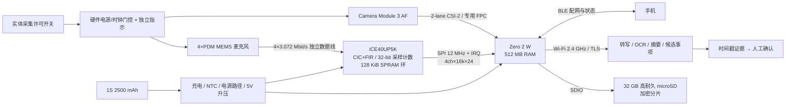

# 系统架构与软件协议

> 来源：[R0 软件与数据协议](../iterations/MeetNote-R0/docs/04_软件与数据协议.md)、[R0 ECAD 约束](../iterations/MeetNote-R0/docs/03_ECAD_constraints.md)、[R1 产品与工程基线](../iterations/MeetNote-R1-design/产品与工程基线.md)、[R3 方案与预算](../iterations/MeetNote-Lite-R3/方案与预算.md)

本文整理数据通路、接口预算、功耗模型与软件协议。**所有吞吐、功耗、内存与时长均为预算值，未经实物测量**；参考实现只覆盖加密分片、原子保存、模拟续传与候选事项结构。

---

## 1. 总体架构



设备只负责**采集、可靠保存、加密与传输**；重 AI（ASR/OCR/摘要/检索）全部在服务器。这决定了它不是离线大模型设备，断网时只能保存、不能回答。

## 2. 三条实现路线

| 路线 | 收益 | 代价与判定 |
|---|---|---|
| **独立 Linux SoC + 小 FPGA（选中）** | 相机生态与联网成熟；独立采样时钟与确定性缓冲隔离 Linux 调度抖动 | 增加 0.08–0.20 W、1.2 V 电源、固件维护；必须证明 4 路可靠采样有收益 |
| 集成 Zynq-7010 类 SoC/FPGA | ARM 与 PL 紧密互联，DMA 强 | 还需 DDR、启动存储、Wi-Fi/BT、相机 ISP/驱动、多路电源；按 3–6 W 系统估算，开发与散热不适合首版 |
| SoC + TLV320ADC6140，无 FPGA | 专用芯片可接 8 路 PDM，输出 TDM，滤波成熟 | 需验证所选 SoC 的 4 路 TDM 驱动与缓冲能力；能稳定满足 R01/R06 则下一版删除 FPGA |

**FPGA 保留门槛**：上传、拍照、SD 同步写入同时发生时，连续 2 h 四路采样无无法解释的缺口；故意暂停主机服务 200 ms 仍保持无损。若普通音频 ADC + DMA 同样满足且功耗更低，FPGA 不进入量产版本。

FPGA 只做四件事：同步采样、PDM 抽取、采样计数时间戳、溢出检测与 SPI 环形缓冲。**不做视频、ASR 或大模型**。时戳依赖同一采样计数器，但照片曝光时刻仍需驱动元数据对齐，不能把拍照请求时间当曝光时间。

## 3. 接口与带宽预算

### 3.1 音频链

| 项 | 数值 | 说明 |
|---|---|---|
| PDM 主时钟 | 12.288 MHz / 4 = 3.072 MHz | 外部音频时钟，避免内部 RC 误差 |
| 抽取 | 总抽取 192 → 16 kHz | CIC + 补偿 FIR，参数需实现并验证通带/混叠 |
| 输出 | 4×16,000×24 bit = 192,000 B/s | 每 20 ms 一帧 |
| FPGA 缓冲 | 128 KiB ≈ 0.683 s，可用约 0.6 s | 不能支撑任意长 Linux 停顿 |
| SPI | 12 MHz，理论 1.5 MB/s | 50% 有效吞吐仍有 3.9 倍余量 |
| 计数器 | 32 bit @16 kHz ≈ 74.6 h 回绕 | 软件扩展为 64 bit |
| 传输校验 | CRC32 + 帧序号 + 首采样计数 | 溢出必须记录 lost_samples 区间 |

### 3.2 相机与 CSI

- 12 MP RAW10 静态帧约 15 MB；10 fps 有效像素负载约 1.2 Gbit/s，仍需叠加消隐/协议。
- 确切 lane rate 由驱动 mode 决定；R0 不声明该模式在 Zero 上的实际吞吐。
- 相机走模组原生两通道，不经过 FPGA 或载板；若新增中介板，必须重做 100 Ω 差分、长度匹配与眼图验证，严禁飞线 MIPI。

### 3.3 屏幕

| 项 | 数值 |
|---|---|
| 型号候选 | 微雪 1.69 英寸 ST7789V2，240×280 |
| 模组包络 | 31.5×39.0 mm，显示区约 27.972×32.634 mm |
| RGB565 全帧 | 240×280×2 = 134,400 B |
| 10 fps | 10.752 Mbit/s |
| 24 MHz SPI @60% | 14.4 Mbit/s（10 fps 有余量，15 fps 的 16.128 Mbit/s 超出） |
| 双缓冲 | 268,800 B |

音频与屏幕优先使用**独立 SPI 控制器**，不能把整帧屏幕写入阻塞音频服务；没有第二总线时需分块 DMA + 优先级调度，并测最坏阻塞，而不是只看平均吞吐。

### 3.4 内存与存储

512 MB 内存预算：OS/服务 180 MB、相机/ISP 缓冲 120 MB、音频/DSP 32 MB、上传/加密 32 MB、应用 48 MB、余量 100 MB。RSS、CMA 与峰值分配必须实测；内存不足时关闭预览，不丢音频。

32 GB 卡（按十进制 GB）分配：OS A/B 8 GB、日志/恢复 2 GB、数据 20 GB、保留 2 GB。

| 数据形态 | 2 h 用量 |
|---|---|
| 4 ch / 16 kHz / 24 bit 原始 PCM | 1.3824 GB |
| 16 kHz / 16 bit 单声道 PCM | 230.4 MB |
| 32 kbit/s Opus | 28.8 MB |
| 120 张照片 × 4 MB | 480 MB |
| 调试模式（4ch PCM + 照片 + 15%） | 约 2.142 GB/场 → 20 GB 约 9 场 |
| 正常上传（单声道 Opus + 照片） | 约 508.8 MB |

5 Mbit/s 上传 508.8 MB 理论 13.6 min，按 80% 效率约 17 min；调试原始数据约 62 min。每 10 s 完成一个独立加密分片，断电最多损失正在写的约 10 s；FPGA 缓冲不能跨掉电保存。

## 4. 功耗、热与续航模型

### 4.1 功耗预算（稳压输出端）

| 负载 | 2 h 典型平均 W | 同时活动峰值 W |
|---|---:|---:|
| SoC + RAM（不含下列独立项） | 1.35 | 2.50 |
| Wi-Fi/BLE 增量 | 0.30 | 0.90 |
| 相机占空比 | 0.10 | 1.20 |
| FPGA + 时钟 + 4 MIC | 0.16 | 0.25 |
| microSD 增量 | 0.15 | 0.40 |
| UI / 轨 / 控制 | 0.10 | 0.20 |
| 余量 | 0.29 | 0.55 |
| **合计** | **2.45** | **6.00** |

这些是整机拆分预算，不能与某个已包含无线/存储的实测 SoC 功耗再相加。

### 4.2 续航公式

```text
可用负载能量 = 3.7 V × 容量 Ah × 0.80（寿命） × 0.88（转换） × 0.90（低电保留）
续航 = 可用负载能量 / 稳压输出端平均功耗
```

2500 mAh → 9.25 Wh → 可用 5.86 Wh：

| 模式 | 负载 | 续航 |
|---|---:|---:|
| R0 连续记录 | 2.45 W | 2.39 h |
| R1 会议 + 间歇点屏 | 2.60 W | 2.25 h |
| R1 持续取景问答 | 3.40 W | 1.72 h |
| R2 含 GNSS + IMU | 2.805 W | 2.09 h |
| 3.0 W 情景 | 3.00 W | 1.95 h |
| 优化后的低功耗记录目标 | 1.20 W | 4.88 h（目标，无平台支持） |

2 h 目标要求实测平均负载 ≤2.93 W，目标 ≤2.45 W 留余量。6 W 输出、3.3 V 电芯、85% 效率意味着约 2.14 A 电池脉冲，所选电芯必须提供 ≥2.5 A 脉冲额定证据，**当前电池页面未证明该能力，因此电池选型未放行**。

### 4.3 热

- 35 °C 环境、接触面目标 ≤43 °C（设计门槛，不是认证结论）。
- R0 估算：平均壳体温升 9–15 °C，35 °C 环境可能达 44–50 °C，**目标不成立**。
- R1 68×90×26 mm、2.6 W 负载、88% 效率：估算平均温升约 28 °C，约 62.8 °C，**FAIL**；54×72×22 mm 约 77.7 °C。
- 触温目标要求 35 °C 时热阻 ≤2.88 K/W，或把总热耗限制到 1.49–2.48 W。
- 热路径：计算芯片 → 导热垫 → 朝外扩散片 → 外壳；背部与电池区控制热耦合。**禁止仅用外壳平均温度推算芯片结温**，必须分别测芯片/电池/前壳/后壳。

结论：热是当前最硬的阻断项之一，靠换外壳材料不能解决；必须降低持续负载、扩大有效散热或改变工作占空比。

## 5. 软件流程

### 5.1 设备状态机

```text
OFF → BOOT_SELFTEST → LOCKED_IDLE → CONSENT_READY → RECORDING → FINALIZING
    → QUEUED → UPLOADING → SERVER_PROCESSING → NEEDS_CONFIRMATION → CONFIRMED
```

从任何采集状态切断物理许可：立即停止 MIC/摄像头硬件采集，封存已有分片并记录原因；新启动不继承同意。断网只切换上传状态，不能停止本地录制。**采集与上传是正交状态**，不允许上传线程反压导致采集阻塞。

### 5.2 设备模块

硬件许可/指示与按键、FPGA DMA/SPI 读取、采样计数与 UTC 映射、音频 HPF/降噪/限幅/VAD、帧/段队列、照片原图与裁切参数、本地事件（能量/长静音/手工标记）、可选小词表关键词检测、AES-GCM 暂存、SQLite WAL 索引、断点上传、BLE 配网、健康监视与签名更新。

参考程序（`pipeline.py`）只实现加密分片、原子保存、模拟续传及候选任务证据结构；VAD/降噪/关键词、实际 FPGA 接口、相机驱动与服务部署均未实现。12 项本机测试覆盖加密往返、AAD/密文篡改、错误密钥、同意/物理许可逻辑、原子文件、续传重启、幂等重试、坏摘要、不完整文件、人工确认与路径/长度检查。

## 6. 文件与加密格式

每个会议一个 UUID，每次启动一个 boot UUID，音频每 10 s 一个独立分片。

```text
.mn 参考格式：
  4 字节 "MN01"
  4 字节大端头长度
  canonical JSON AAD
  AES-256-GCM 密文（末尾 16 字节认证 tag）
```

- AAD 包含 meeting_id、boot_id、consent_event_id、sequence、采样范围、格式、nonce、key_id；**AAD 可见，不能放会议标题/姓名**。
- 密文文件 SHA-256 只用于传输完整性，不能替代 GCM 认证。
- 每会随机 256 bit DEK；生产系统用安全硬件/用户密钥解封本地 DEK，需要服务器处理时以 KMS 公钥包装 DEK、TLS 上传密钥信封。**设备自身可解密，因此不能称端到端加密**。
- Zero 2 W 无已集成安全元件的证据，**本地防失窃密钥保护是阻断项**：不能把密钥与 SD 卡密文放在一起就声称失窃保护。
- nonce 随机 96 bit；每会独立 DEK 并设置分片数上限、检测重复；重启后归零的序号不能直接当 nonce。使用成熟密码库，不自制密码。

## 7. 服务端 API 草案

完整机器可读定义见 [`openapi.yaml`](../iterations/MeetNote-R0/software/openapi.yaml)。所有网络端点生产要求 TLS 与设备认证；token scope 绑定 tenant/device/meeting，不能由客户端任意指定访问者。BLE 只承载实体键发起的限时配网交换、Wi-Fi 凭据和状态，不传会议内容。

| 方法 | 路径 | 作用 |
|---|---|---|
| POST | `/v1/meetings` | 幂等键、同意事件、格式版本 → meeting UUID |
| POST | `/v1/meetings/{id}/uploads` | 创建绑定 chunk UUID / 密文 SHA / 大小的 upload |
| HEAD | `/v1/uploads/{id}` | 返回已持久化 Upload-Offset |
| PATCH | `/v1/uploads/{id}` | 上传二进制片段，严格校验 offset / Content-Length；409 后 HEAD 重对齐 |
| POST | `/v1/uploads/{id}/complete` | 长度与 SHA 正确后幂等提交；服务端确认后设备才清理本地缓存 |
| POST | `/v1/meetings/{id}/process` | 授权解封、转写、说话人匿名分段、OCR、摘要与候选任务；job_id 异步查询 |
| GET | `/v1/meetings/{id}/results` | 每条结果附原始 chunk SHA、样本区间/照片 ID、模型版本、置信提示 |
| POST | `/v1/meetings/{id}/confirmations` | 人工确认/修改/拒绝，需结果版本与 If-Match，防止误确认过时建议 |

R1 新增助理接口（尚未加入 R0 OpenAPI，也未部署）：

- `POST /v1/assistant/requests`（client_request_id、capture_mode、已上传 asset_ids、授权 scope、response_mode）
- `GET /v1/assistant/requests/{id}`（状态、回答、证据、费用/用量可选）
- `POST /v1/assistant/requests/{id}/cancel`
- `POST /v1/actions/{id}/confirm`（当前版本、明确动作参数）

R1 请求状态：`CREATED → LOCAL_SAVED → QUEUED → UPLOADING → PROCESSING → ANSWER_READY / NEEDS_CONFIRMATION`，另有 `FAILED / CANCELLED`。采集、上传、推理是独立状态域；服务器回答迟到必须按 request_id 匹配，已取消或新一轮提问不能被旧回答覆盖。取消不保证消除已发生的云端成本，UI 需正确反映。

## 8. 证据结构

至少包含：`record_id`、`asset_hash`、`audio_sample_start/end` 或 `photo_id`、时间锚点、`model_version`、`confidence_hint`；负责人/时间不确定时保留 `null` 和原文。

- 个人明确口述的提醒可形成待确认卡片。
- 会议转写中的行动语句**始终是候选**，不自动执行。
- 外部通信或日历变更等有副作用的动作，必须显示具体对象、内容与时间，经确认后执行，并保存结果与审计 ID。
- 新增输出音频不能混入用户证据；播放 ID 和区间单独记录。

## 9. 恢复、低电量与更新

- 分片先写 `.partial`，`fsync` 后原子 rename，再事务更新索引；启动时扫描孤立已完成文件恢复索引，未完成文件隔离。
- 断点测试只证明磁盘模拟行为；生产服务需数据库事务/租约，防并发 PATCH 竞态。
- Wi-Fi 重连指数退避 + 随机抖动；5xx/408/429 按 Retry-After；401 刷新身份后最多重试一次；403 停止并提示；422 隔离坏分片。
- 电量预测：剩余 15 min 提示、5 min 关闭相机与上传、2 min 封存并正常关机；瞬时欠压立即结束当前段并保存。阈值需按电量计/负载/内阻实测校准。
- 系统更新采用 OS A/B 槽、签名 manifest/镜像、版本反回滚、设备健康确认与失败回滚；更新前必须停止录制、接电或足够电量并有恢复入口。FPGA bitstream 与主机协议版本绑定，不可跨版本混用。

## 10. 边界

- 无固件、无 bitstream、无驱动、无服务端部署。
- `POWER_ASSEMBLY`、`12M288_XO`、`HARD_INTERLOCK` 是接口占位，不是已实现电路。
- 加密、密钥、失窃防护、安全更新均为设计草案。
- 功耗、内存、吞吐、延迟全部是预算/假设，需按 [05-风险与验证计划](05-风险与验证计划.md) 实测。
