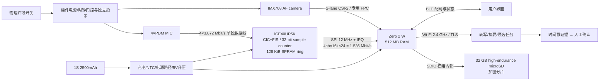

# MeetNote R0 产品基线与可行性

日期：2026-09-29。状态：工程概念原型，不是投板放行版。所有 W、温升、续航与最小尺寸均为设计估算，尚无实物测试。R0 采用模块化 Linux SoC + 独立 FPGA；资料未覆盖的引脚、供货、结构与功耗不作已验证承诺。

## 需求假设及验收条件

|ID|基线|验收办法（待实测）|
|---|---|---|
|R01|桌面 4–8 人、距离 0.5–3 m、普通会议室；语音优先，2 小时连续记录|8 人真实会议，混响和空调噪声下人工标注对照|
|R02|每次录制前由操作者确认所有参会者知情同意；默认上电不录制，断电重启不自动恢复采集|冷启动、崩溃重启、撤回同意演练|
|R03|实体双极开关切断 MIC_CAPTURE 许可和 CAMERA_CAPTURE 许可；分别有硬件状态灯，软件显示补充|卡死应用/内核，切断许可后示波器确认采集停止；验证旁路/反向供电|
|R04|摄像头仅按键拍摄白板、投影和材料；预览最多 30 s，默认不上传视频|审查上传 manifest 中只有音频与手动静态图|
|R05|1×/1.5×/2×数字裁切，自动对焦，保留原图；2×只剩约 3 MP，不承诺远处小字可读|3 m 白板/投影文字清晰度和闪烁测试|
|R06|断网加密暂存、重连续传，不覆盖未确认上传的数据|断网 2 h，50 次随机中断重启，文件哈希和连续时间轴对照|
|R07|断网不会阻止开始录制；存储不足、密钥不可用、硬件许可未开启会阻止录制|逐个故障注入|
|R08|自动摘要、负责人、期限和决定只标为候选；用户确认前不分派、不推送给他人|每条结果可跳转原始音频时间范围及照片|
|R09|操作：实体许可开关、录制/停止键、拍照键、裁切 ±；录制红灯、摄像黄灯、上传蓝灯、错误闪烁|无需手机也能开始/停止并辨认错误；BLE 仅配网/状态|
|R10|目标环境 10–35°C、室内无防水要求；外壳触及面目标 ≤43°C，电池充电温度遵从电芯规格|35°C 恒温、满负荷和充电测试；不是安全认证结论|
|R11|保留期默认 30 天、可导出/删除；权限按会议隔离；首次使用设置设备所有者|越权和删除审计，失窃威胁模型检查|

## 架构选择

**采用** Raspberry Pi Zero 2 W（RP3A0、512 MB LPDDR2、Wi-Fi/BLE、microSD、CSI）+ iCE40UP5K-SG48；四枚 IM69D130 PDM 麦克风。R0 使用现成计算模组避开 DDR/RF 自研。Camera Module 3 Standard 的原生 CSI 排线直接到 Zero，不经过 FPGA 或载板。FPGA 专用于四路同相时钟采样、PDM 抽取、采样计数时间戳、溢出检测和 SPI 环形缓冲；不做视频、ASR 或大模型。

|路线|收益|代价与判定|
|---|---|---|
|独立 Linux SoC + 小 FPGA（选中）|相机软件生态与联网成熟；独立采样时钟和确定性缓冲隔离 Linux 调度抖动|额外 0.08–0.20 W、1.2 V 电源、固件维护；必须证明 4 路可靠采样有收益|
|集成 Zynq-7010 类 SoC/FPGA|ARM 与 PL 紧密互联，DMA 强|还需 DDR、启动存储、Wi-Fi/BT、相机 ISP/驱动、多路电源；按 3–6 W 系统估算，开发和散热不适合首版。不是芯片官方功耗值|
|SoC + TLV320ADC6140，无 FPGA|专用芯片可接 8 路 PDM，输出 TDM，滤波成熟|需验证所选 SoC 的 4 路 TDM 驱动与缓冲能力；若能稳定满足 R01/R06，则下一版删除 FPGA|

**FPGA 保留门槛**：在服务器上传、拍照、SD 同步写入同时发生时，连续 2 h 四路采样无无法解释的缺口；故意暂停主机服务 200 ms 仍保持无损。若普通音频 ADC + DMA 同样满足且功耗更低，FPGA 不进入量产版本。时戳依赖同一采样计数器，但照片曝光时刻仍需驱动元数据对齐，不能把拍照请求时间当曝光时间。

## 数据通路、内存及接口

- PDM 主时钟取外部音频时钟 12.288 MHz / 4，避免内部 RC 误差；抽取至 16 kHz（总抽取 192，CIC+补偿 FIR 参数需实现并验证通带/混叠）。四根独立 DATA 避免双沿共享线调试；I/O 3.3 V，FPGA core 1.2 V，VPP/PLL 供电必须按原厂参考设计复核。
- 输出 4×16,000×24 bit = 192,000 B/s；128 KiB 理论只缓冲 0.683 s，扣除头部、状态和空间余量后约 0.6 s；驱动目标每 20 ms 读取，200 ms 抖动测试。不能支撑任意长 Linux 停顿。
- SPI 12 MHz 理论 1.5 MB/s，以 50% 有效吞吐估算仍有 3.9 倍余量；传输 CRC32、序号和第一采样计数，计数器 32 bit 在 16 kHz 下约 74.6 h 回绕，软件扩展为 64 bit。
- CSI 使用模组原生两通道；12 MP RAW10 静态帧约 15 MB，10 fps 有效像素负载约 1.2 Gbit/s，仍需叠加消隐/协议。确切 lane rate 由驱动 mode 决定，R0 不声明该模式在 Zero 上的实际吞吐；静态拍照无需持续最高速。
- SoC 内存预算：OS/服务 180 MB、相机/ISP缓冲 120 MB、音频/DSP 32 MB、上传/加密 32 MB、应用 48 MB、余量 100 MB，共 512 MB。RSS、CMA 和峰值分配必须实测，内存不足时关闭预览，不丢音频。
- Wi-Fi 有效上传目标 ≥5 Mbit/s（不是 PHY 速率），BLE 和 Wi-Fi 共用 2.4 GHz 空间，BLE 配网结束后降占空比。USB-C 首版仅充电；调试 UART/SPI 为内部焊盘；不宣称已完成 USB 数据或 PD。

## 相机路线比较

|项目|固定焦距/自动对焦 + 数字裁切（选中 AF）|小型光学变焦（未选定器件）|
|---|---|---|
|包络|Camera Module 3 Standard 25×24×11.5 mm，另留 1.5 mm 光学/壳体间隙|设计预留 25–40×25–40×25–45 mm；这是占位范围，未取得供应商图纸|
|活动空间|VCM 活动在模组内部；保护窗口不可顶住镜头|额外约 5–15 mm 行程/排线松弛量，必须有运动全程包络|
|功耗估算|拍照/预览 0.6–1.2 W、AF 短时峰值额外约 0.2 W；间歇拍照均值 0.10 W|采集 1–2 W、马达动作峰值额外 0.5–2 W，均未实测|
|对焦/稳定性|AF 狩猎、投影闪烁、低照度手抖；无 OIS；优先桌面固定拍照|变倍后重对焦、回差与标定更难；长焦更易抖；不能假设带 OIS|
|文字效果|2×裁切像素面积为 1/4，应保留原图并提示清晰度不足|真实细节可能改善，但取决于镜头 MTF 与曝光，不能只凭倍率判断|
|尺寸代价|适配 29 mm 厚 R0|可能使整机厚度 ≥40–60 mm；折叠潜望式需要定制供应链，不纳入当前尺寸承诺|

## 功耗、热与续航（估算）

|负载，稳压输出端|2h典型平均 W|同时活动峰值 W|
|---|---:|---:|
|SoC + RAM（不含下列独立项）|1.35|2.50|
|Wi-Fi/BLE 增量|0.30|0.90|
|camera duty cycle|0.10|1.20|
|FPGA + clock + 4 MIC|0.16|0.25|
|microSD 增量|0.15|0.40|
|UI/rails/控制|0.10|0.20|
|余量|0.29|0.55|
|合计|2.45|6.00|

这些是整机拆分的预算值，不能与某个已包含无线/存储的实测 SoC 功耗再相加。电池 3.7 V×2.5 Ah=9.25 Wh；寿命容量系数 0.80、转换效率 0.88、低电量保留 0.90：可用负载能量 5.86 Wh，典型续航 **2.39 h**。3.0 W 时仅 1.95 h；2h 目标必须实测平均负载 ≤2.93 W，目标 ≤2.45 W 留余量。充电器输入应有协商/限流：默认 USB 只取 500 mA，无法保证边录边充；合格 5 V 2 A 电源仅在检测授权电流后使用。6 W 输出、3.3 V 电芯、85%效率意味着 2.14 A 电池脉冲，选用电芯必须提供 ≥2.5 A 脉冲额定证据；现选电池页面未证明该能力，故电池选型未放行。

稳态电池输入约 2.45/0.88=2.78 W，热预算近似按全输入转热；面积 A=2(0.082×0.118+0.082×0.029+0.118×0.029)=0.03095 m²，等效换热 h=6–10 W/m²K，平均壳体温升估算 9–15°C。35°C 环境可能达到 44–50°C，**43°C目标尚不成立**。采取前部铝扩散片（避天线/电池）+ 导热垫、暂停充电/上传/预览降低负载，仍必须测试。触温目标要求 35°C 时热阻 ≤2.88 K/W 或把总热耗限制到 1.49–2.48 W；禁止仅用外壳平均温度推算芯片结温。线性充电额外损耗按(5−3.7)×0.5≈0.65 W，录制时默认暂停快充。

## 存储预算

2h 原始 4ch/16k/24 PCM=1.3824 GB（十进制）；16k/16bit 单声道 PCM=230.4 MB；32 kbit/s Opus=28.8 MB；120 张照片×4 MB=480 MB。调试保留 4ch PCM + 照片约 1.8624 GB，另加 15%余量=2.142 GB/会。正常上传单声道 Opus + 照片约 508.8 MB。32 GB 卡分配 OS A/B 8 GB、日志/恢复 2 GB、数据 20 GB、保留 2 GB，可容纳约 9 场调试模式会议；格式化/坏块/实际 JPEG 大小会改变结果。不要误用 32 GiB。

5 Mbit/s 上传 508.8 MB 理论 13.6 min，按80%效率约17 min；调试原始数据需约62 min。默认只上传整理后音频与手拍图，是否上传多通道原始音频由用户选择。每 10 s 完成一个独立加密分片，断电最多损失正在写的约 10 s；FPGA缓冲不能跨掉电保存。

## 尺寸及制造约束

推荐可编辑装配：**82×118×29 mm**（宽×长×厚），四枚 M2 紧固件、1.8 mm壁、独立电池舱、原生相机板与排线、零件可拆修；载板 70×70×1.6 mm。Zero 板处于独立上端舱，载板和电池不压到其天线投影下。质量估算 120–160 g（电池约50 g）。

“最小可行尺寸”只可给出条件化设计下限：**78×110×26 mm**，需定制短排线、薄连接器、确认电芯膨胀公差、实测热点与天线性能；本次未做该尺寸装配验证，因此不能称已证实的可制造下限。小于约 70×100×22 mm 需要小型 SoM/相机裸模组/定制电芯重新设计，不靠压缩模型实现。

z向预算：底壁1.8 + 电池间隙0.4 + 电池7.3 + 顶部膨胀/装配余量2.1 + 载板1.6 + camera垫高0.8 + camera包络11.5 + 光学间隙1.7 + 顶壁1.8 = 29.0 mm。顶部玻璃/快门增加的厚度必须从光学间隙真实扣除。镜头保护结构当前为孔和快门占位，不是已选定光学玻璃。

## 阶段判定

物理布局具有进一步做样机的空间；**续航、35°C触温、无线、电池脉冲能力仍是未关闭风险**。允许推进可编辑 R0 草案来揭露干涉和接口问题，不允许据此投板或承诺整机达标。下一版先做供电/热台架，再做真实会议音频，最后带壳验证相机文字与无线。完整交付状态见 verification/验收记录.md。
